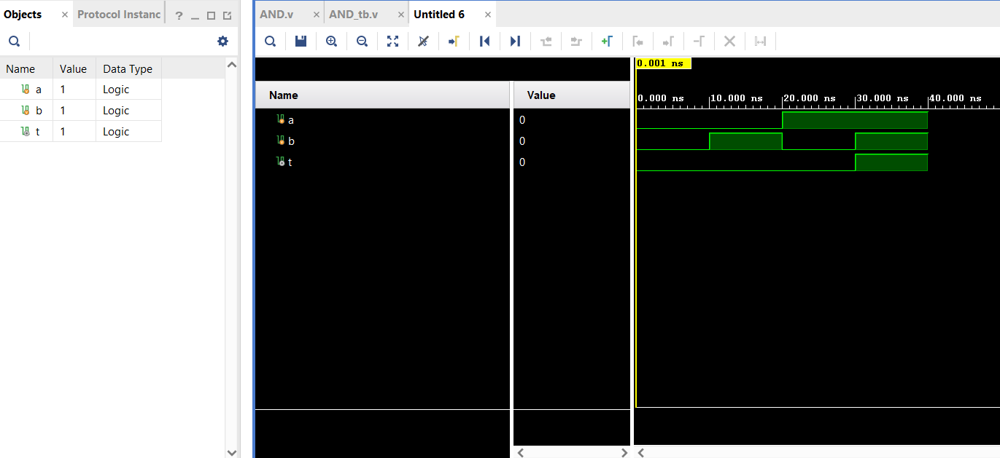

# Basic Logic Gates in Verilog

Implementation of all the fundamental logic gates like And,OR,Not etc in Dataflow,Gate and Behavioral level Modelling with individual testbenches.Also verified the truthtable of all gates against the simulation waveforms.


## Table of Contents

* [Overview](#overview)
* [Repository Structure](#repository-structure)
* [Gates Implemented](#gates-implemented)
* [Individual Gate Breakdowns](#individual-gate-breakdowns)
* [Concepts Covered](#concepts-covered)
* [Tools Used](#tools-used)
* [Author](#author)

# Overview
This is my first repository of building my career in this field of
Processors and Microcontrollers that we use in our day to day life. 

Every component of a digital system fromm a adder to Processors all come from the usage of the basic logic gates at the transistor level.This repository implements all 7 fundamental gates individually, each with its own dedicated Verilog module, testbench, and verified simulation waveform.

Each gate is implemented in Dataflow,Gate and Behavioral level modelling in the  RTL design — and verified against its complete truth table.
# Repository Structure

```text
Logic_Gates/
│
├── src/                            # Verilog HDL design source files
│   ├── and_gate/                   # 2-Input AND gate design variants
│   │   ├── AND_Behave.v            # Behavioral procedural model style
│   │   ├── AND_Data.v              # Dataflow continuous assignment style
│   │   └── AND_Gate.v              # Structural low-level primitive style
│   │
│   ├── or_gate/                    # 2-Input OR gate design variants
│   │   ├── OR_Behave.v             # Behavioral procedural model style
│   │   ├── OR_Data.v               # Dataflow continuous assignment style
│   │   └── OR_Gate.v               # Structural low-level primitive style
│   │
│   ├── not_gate/                   # Single-Input NOT gate design variants
│   │   ├── NOT_Behave.v            # Behavioral procedural model style
│   │   ├── NOT_Data.v              # Dataflow continuous assignment style
│   │   └── NOT_Gate.v              # Structural low-level primitive style
│   │
│   ├── nand_gate/                  # 2-Input Universal NAND gate variants
│   │   ├── NAND_Behave.v           # Behavioral procedural model style
│   │   ├── NAND_Data.v             # Dataflow continuous assignment style
│   │   └── NAND_Gate.v             # Structural low-level primitive style
│   │
│   ├── nor_gate/                   # 2-Input Universal NOR gate variants
│   │   ├── NOR_Behave.v            # Behavioral procedural model style
│   │   ├── NOR_Data.v              # Dataflow continuous assignment style
│   │   └── NOR_Gate.v              # Structural low-level primitive style
│   │
│   ├── xor_gate/                   # 2-Input Arithmetic XOR gate variants
│   │   ├── XOR_Behave.v            # Behavioral procedural model style
│   │   ├── XOR_Data.v              # Dataflow continuous assignment style
│   │   └── XOR_Gate.v              # Structural low-level primitive style
│   │
│   └── xnor_gate/                  # 2-Input Arithmetic XNOR gate variants
│       ├── XNOR_Behave.v           # Behavioral procedural model style
│       ├── XNOR_Data.v             # Dataflow continuous assignment style
│       └── XNOR_Gate.v             # Structural low-level primitive style
│
├── tb/                             # Verification testbench suite
│   ├── AND_tb.v                    # Verification engine for AND gate
│   ├── OR_tb.v                     # Verification engine for OR gate
│   ├── NOT_tb.v                    # Verification engine for NOT gate
│   ├── NAND_tb.v                   # Verification engine for NAND gate
│   ├── NOR_tb.v                    # Verification engine for NOR gate
│   ├── XOR_tb.v                    # Verification engine for XOR gate
│   └── XNOR_tb.v                   # Verification engine for XNOR gate
│
└── README.md                       # Comprehensive portfolio documentation
```

# Gates Implemented


| # | Gate | Symbol | Boolean Expression | Gate Type |
| :---: | :--- | :---: | :--- | :--- |
| 1 | AND | `&` | Y = A · B | Basic |
| 2 | OR | `\|` | Y = A + B | Basic |
| 3 | NOT | `~` | Y = Ā | Basic |
| 4 | NAND | `~&` | Y = ¬(A · B) | Universal |
| 5 | NOR | `~\|` | Y = ¬(A + B) | Universal |
| 6 | XOR | `^` | Y = A ⊕ B | Arithmetic |
| 7 | XNOR | `~^` | Y = ¬(A ⊕ B) | Arithmetic |

> **Note:** NAND and NOR are called Universal Gates because any Boolean function can be implemented using only these two gates.

# Individual Gate Breakdowns

### 1. AND Gate 

The AND gate is a fundamental building block that performs logical multiplication. The output goes high `1` only when both inputs `A` and `B` are simultaneously high `1`.

#### Truth Table

| Input A | Input B | Output Y |
| :---: | :---: | :---: |
| 0 | 0 | 0 |
| 0 | 1 | 0 |
| 1 | 0 | 0 |
| 1 | 1 | 1 |

####  Simulation Waveform



####  Unified Simulation Analysis
A single testbench verification engine `tb/AND_tb.v` was used to validate all three design variants. The simulation waveform confirms that **Structural, Dataflow, and Behavioral all yields the identical logical behavior and we can validate the waveform against the truth table to see that the waveform is correct.**


#### Waveform & Code Variant Analysis
* **Structural Model `AND_Gate.v`:** Instantiates the primitive gate engine `and g1(Y, A, B);`, which matches the fundamental transistor-level schematic.
* **Dataflow Model `AND_Data.v`:** Utilizes continuous assignment `assign Y = A & B;`, modeling real wire physical connections that are always active.
* **Behavioral Model `AND_Behave.v`:** Leverages an `always @(*)` procedural block. The waveform demonstrates that the output updates instantaneously when either input changes, verifying correct combinational behavior without any clock latency.


# Concepts Covered

### Verilog

* `module` and `endmodule` — defining a hardware block
* `input wire` and `output wire` — port declarations
* Bitwise operators — `&`, `|`, `~`,`~&`, `~|`,`^`,`~^`
* Testbench structure — `reg`, `initial block`, `$display`, `$dumpfile`, `$dumpvars`, `$finish`
* Module instantiation — named port connection syntax `.port(signal)`

### Digital Design

* Behaviour of all 7 fundamental gates
* NAND and NOR as universal gates — any circuit can be built from only these
* XOR as the sum generator in binary addition — foundation of the ALU
*  Learned to simulate all Logic gates in all 3 kind of modelling.

# Tools Used


| Tool | Purpose |
| :--- | :--- |
| **Vivado 2023.2** | Compilation,design entry and waveform simulation |
| **Git** | Version control  |

# Author

Akhilesh M B.Tech ECE, 2nd year Building a good Protfolio for my Future Career for having a better understanding of the Processors and Microprocessors.

[](https://github.com/akhileshm21)


