# Basic Logic Gates in Verilog

Implementation of all the fundamental logic gates like AND, OR, NOT, etc., using Dataflow, Gate, and Behavioral level Modeling with individual testbenches. Also verified the truth table of all gates against the simulation waveforms.

## Table of Contents

* [Overview](#overview)
* [Repository Structure](#repository-structure)
* [Gates Implemented](#gates-implemented)
* [Individual Gate Breakdowns](#individual-gate-breakdowns)
  * [1. AND Gate](#1-and-gate)
  * [2. OR Gate](#2-or-gate)
  * [3. NOT Gate](#3-not-gate)
  * [4. NAND Gate](#4-nand-gate)
  * [5. NOR Gate](#5-nor-gate)
  * [6. XOR Gate](#6-xor-gate)
  * [7. XNOR Gate](#7-xnor-gate)
* [Concepts Covered](#concepts-covered)
* [Tools Used](#tools-used)
* [Author](#author)

---

## Overview
This is my first repository towards building my career in the field of Processors and Microcontrollers that we use in our day-to-day lives.

Every component of a digital system—from a simple adder to complex processors—originates from the utilization of basic logic gates at the transistor level. This repository implements all 7 fundamental gates individually, each with its own dedicated Verilog module, testbench suite, and verified simulation waveform.

Each gate is implemented across Dataflow, Gate (Structural), and Behavioral level modeling styles in RTL design—and fully verified against its respective truth table.

---

## Repository Structure

```text
Logic_Gates/
│
├── docs/                           # Circuit schematic diagram assets
│   ├── 1_and_diagram.png           # 2-Input AND Gate schematic
│   ├── 2_or_diagram.png            # 2-Input OR Gate schematic
│   ├── 3_not_diagram.png           # Single-Input NOT Gate schematic
│   ├── 4_nand_diagram.png          # Universal NAND Gate schematic
│   ├── 5_nor_diagram.png           # Universal NOR Gate schematic
│   ├── 6_xor_diagram.png           # Arithmetic XOR Gate schematic
│   └── 7_xnor_diagram.png          # Arithmetic XNOR Gate schematic
│
├── sim/                            # Simulation output waveform assets
│   ├── 1_and_waveform.png          # AND Gate functional waveform
│   ├── 2_or_waveform.png           # OR Gate functional waveform
│   ├── 3_not_waveform.png          # NOT Gate functional waveform
│   ├── 4_nand_waveform.png         # NAND Gate functional waveform
│   ├── 5_nor_waveform.png          # NOR Gate functional waveform
│   ├── 6_xor_waveform.png          # XOR Gate functional waveform
│   └── 7_xnor_waveform.png         # XNOR Gate functional waveform
│
├── src/                            # Verilog HDL design source files
│   ├── 1_and_gate/                   # 2-Input AND gate design variants
│   │   ├── AND_Behave.v            # Behavioral procedural model style
│   │   ├── AND_Data.v              # Dataflow continuous assignment style
│   │   └── AND_Gate.v              # Structural low-level primitive style
│   │
│   ├── 2_or_gate/                    # 2-Input OR gate design variants
│   │   ├── OR_Behave.v             # Behavioral procedural model style
│   │   ├── OR_Data.v               # Dataflow continuous assignment style
│   │   └── OR_Gate.v               # Structural low-level primitive style
│   │
│   ├── 3_not_gate/                   # Single-Input NOT gate design variants
│   │   ├── NOT_Behave.v            # Behavioral procedural model style
│   │   ├── NOT_Data.v              # Dataflow continuous assignment style
│   │   └── NOT_Gate.v              # Structural low-level primitive style
│   │
│   ├── 4_nand_gate/                  # 2-Input Universal NAND gate variants
│   │   ├── NAND_Behave.v           # Behavioral procedural model style
│   │   ├── NAND_Data.v             # Dataflow continuous assignment style
│   │   └── NAND_Gate.v             # Structural low-level primitive style
│   │
│   ├── 5_nor_gate/                   # 2-Input Universal NOR gate variants
│   │   ├── NOR_Behave.v            # Behavioral procedural model style
│   │   ├── NOR_Data.v              # Dataflow continuous assignment style
│   │   └── NOR_Gate.v              # Structural low-level primitive style
│   │
│   ├── 6_xor_gate/                   # 2-Input Arithmetic XOR gate variants
│   │   ├── XOR_Behave.v            # Behavioral procedural model style
│   │   ├── XOR_Data.v              # Dataflow continuous assignment style
│   │   └── XOR_Gate.v              # Structural low-level primitive style
│   │
│   └── 7_xnor_gate/                  # 2-Input Arithmetic XNOR gate variants
│       ├── XNOR_Behave.v           # Behavioral procedural model style
│       ├── XNOR_Data.v             # Dataflow continuous assignment style
│       └── XNOR_Gate.v             # Structural low-level primitive style
│
├── tb/                             # Verification testbench suite
│   ├── 1_and_tb.v                  # Verification engine for AND gate
│   ├── 2_or_tb.v                   # Verification engine for OR gate
│   ├── 3_not_tb.v                  # Verification engine for NOT gate
│   ├── 4_nand_tb.v                 # Verification engine for NAND gate
│   ├── 5_nor_tb.v                  # Verification engine for NOR gate
│   ├── 6_xor_tb.v                  # Verification engine for XOR gate
│   └── 7_xnor_tb.v                 # Verification engine for XNOR gate
│
└── README.md                       # Comprehensive portfolio documentation
```

---

## Gates Implemented

| # | Gate | Symbol | Boolean Expression | Gate Type |
| :---: | :--- | :---: | :--- | :--- |
| 1 | AND | `&` | Y = A · B | Basic |
| 2 | OR | `\|` | Y = A + B | Basic |
| 3 | NOT | `~` | Y = Ā | Basic |
| 4 | NAND | `~&` | Y = -(A · B) | Universal |
| 5 | NOR | `~\|` | Y = -(A + B) | Universal |
| 6 | XOR | `^` | Y = A ⊕ B | Arithmetic |
| 7 | XNOR | `~^` | Y = -(A ⊕ B) | Arithmetic |

> **Note:** NAND and NOR are called Universal Gates because any arbitrary Boolean function can be implemented using only combinations of these two gate types.

---

## Individual Gate Breakdowns

### 1. AND Gate 
The AND gate is a fundamental building block that performs logical multiplication. The output goes high (`1`) only when both inputs `A` and `B` are simultaneously high (`1`).

#### Truth Table

| Input A | Input B | Output Y |
| :---: | :---: | :---: |
| 0 | 0 | 0 |
| 0 | 1 | 0 |
| 1 | 0 | 0 |
| 1 | 1 | 1 |

#### Simulation Waveform
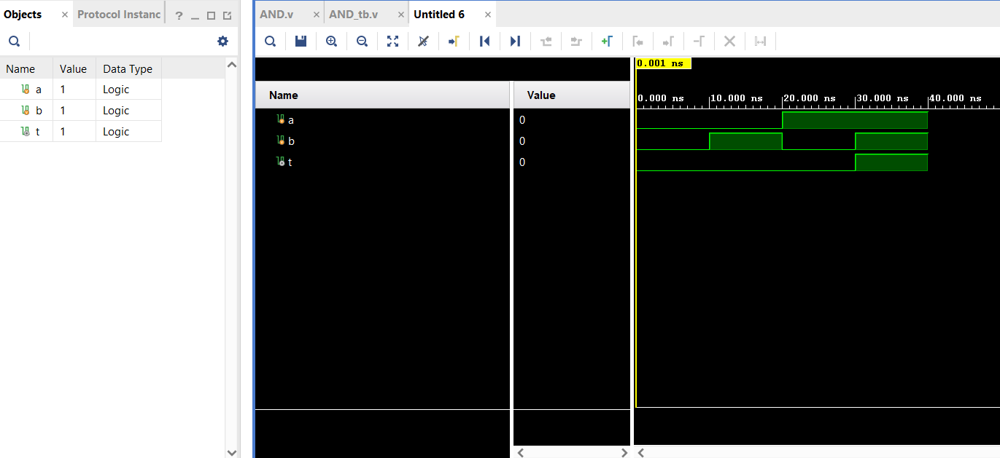

#### Design Schematic
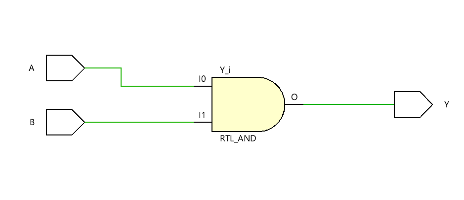


---

### 2. OR Gate
The OR gate performs logical addition. The output goes high (`1`) if one or both inputs `A` and `B` are high (`1`).

#### Truth Table

| Input A | Input B | Output Y |
| :---: | :---: | :---: |
| 0 | 0 | 0 |
| 0 | 1 | 1 |
| 1 | 0 | 1 |
| 1 | 1 | 1 |

#### Simulation Waveform
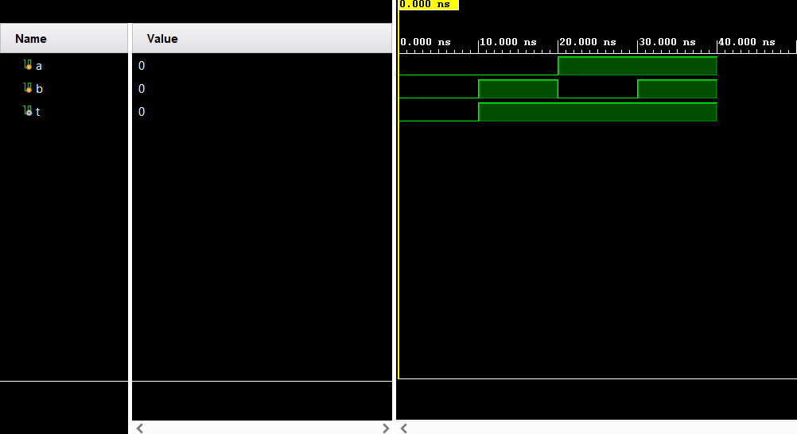

#### Design Schematic
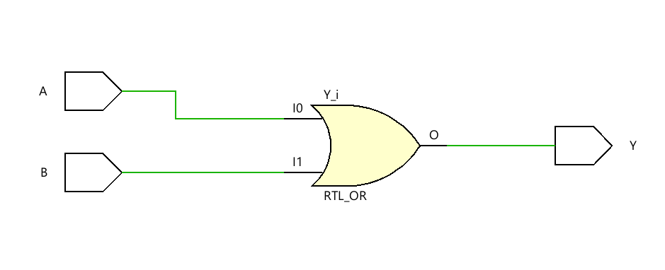

---

### 3. NOT Gate
The NOT gate acts as an inverter. It changes a high signal (`1`) to low (`0`) and vice-versa.

#### Truth Table

| Input A | Output Y |
| :---: | :---: |
| 0 | 1 |
| 1 | 0 |

#### Simulation Waveform
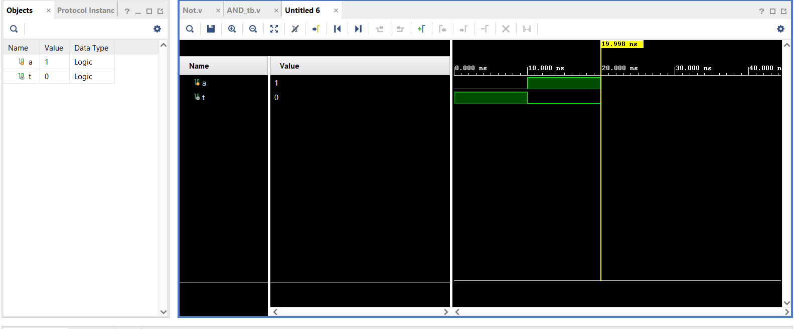

#### Design Schematic
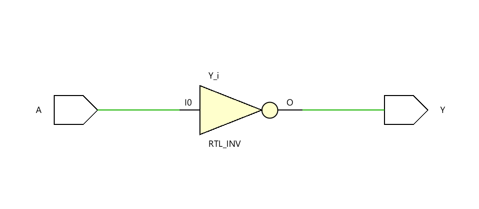

---

### 4. NAND Gate
The NAND gate behaves as an inverted AND gate. The output is low (`0`) only when all its inputs are high (`1`).

#### Truth Table

| Input A | Input B | Output Y |
| :---: | :---: | :---: |
| 0 | 0 | 1 |
| 0 | 1 | 1 |
| 1 | 0 | 1 |
| 1 | 1 | 0 |

#### Simulation Waveform
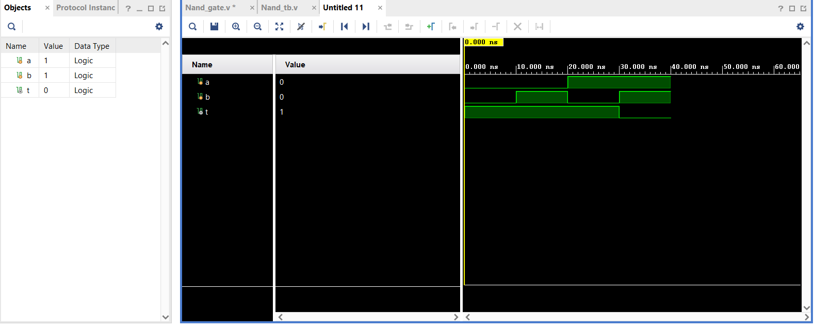

#### Design Schematic
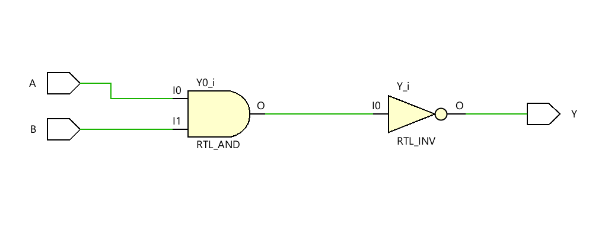

---

### 5. NOR Gate
The NOR gate is an inverted OR gate. The output is high (`1`) only when both inputs are low (`0`).

#### Truth Table

| Input A | Input B | Output Y |
| :---: | :---: | :---: |
| 0 | 0 | 1 |
| 0 | 1 | 0 |
| 1 | 0 | 0 |
| 1 | 1 | 0 |

#### Simulation Waveform
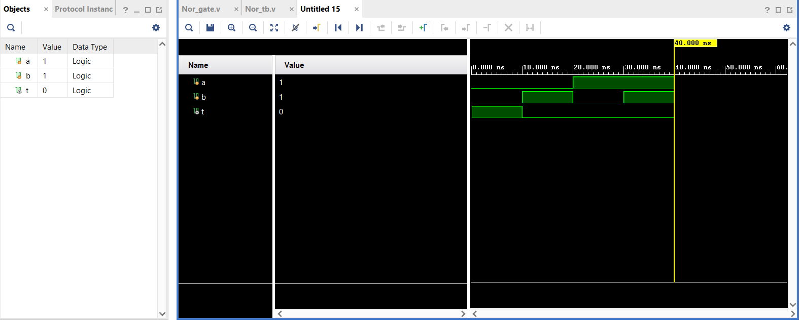

#### Design Schematic
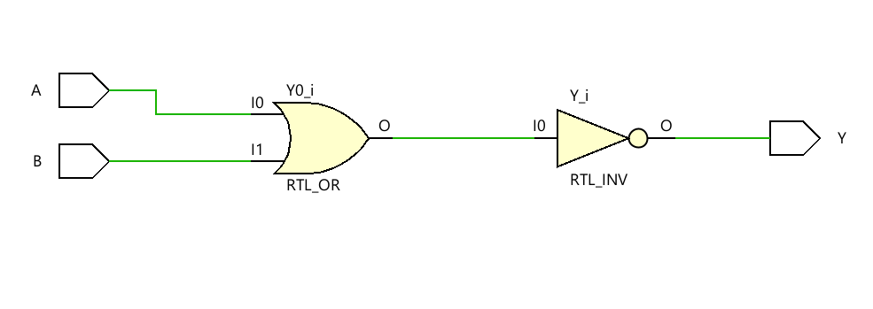

---

### 6. XOR Gate
The Exclusive-OR gate outputs a high (`1`) only when the inputs are different from each other.

#### Truth Table

| Input A | Input B | Output Y |
| :---: | :---: | :---: |
| 0 | 0 | 0 |
| 0 | 1 | 1 |
| 1 | 0 | 1 |
| 1 | 1 | 0 |

#### Simulation Waveform
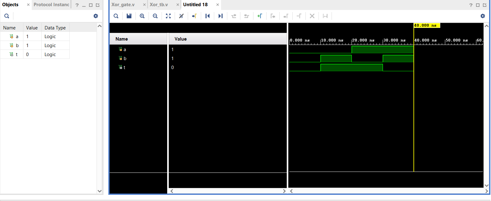

#### Design Schematic
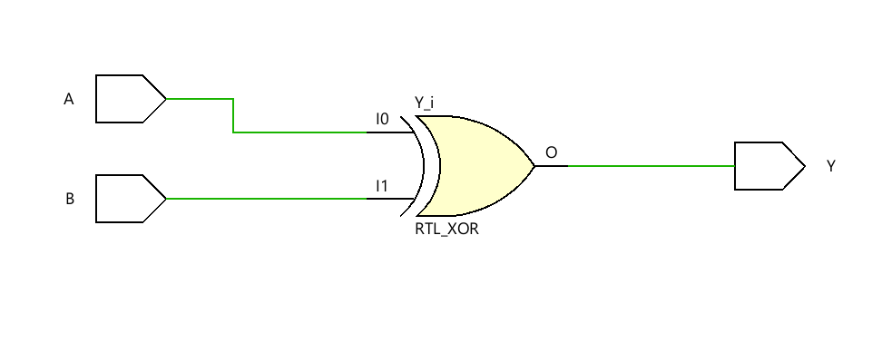

---

### 7. XNOR Gate
The Exclusive-NOR gate is an inverted XOR gate. It outputs a high (`1`) only when the inputs are identical.

#### Truth Table

| Input A | Input B | Output Y |
| :---: | :---: | :---: |
| 0 | 0 | 1 |
| 0 | 1 | 0 |
| 1 | 0 | 0 |
| 1 | 1 | 1 |

#### Simulation Waveform
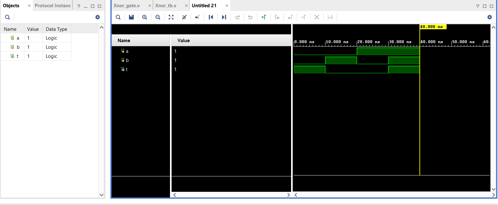

#### Design Schematic
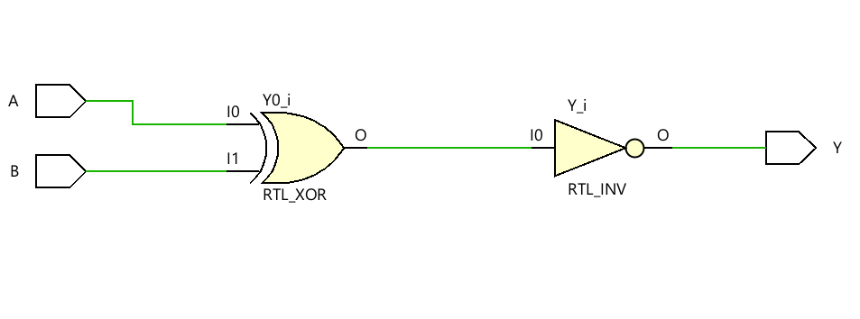

---

## Concepts Covered

### Verilog HDL
* `module` and `endmodule` — defining custom hardware blocks
* `input wire` and `output wire` — port directionality and net declarations
* Bitwise hardware operators — `&`, `|`, `~`, `~&`, `~|`, `^`, `~^`
* Testbench structure & Stimulus generation — usage of `reg`, `initial` blocks, `$display`, `$monitor`, and `$finish`
* Module instantiation — explicit named port mapping syntax `.port_name(local_signal)`

### Digital Logic Design
* Combinational logic characteristics of all 7 core gates
* Proof of universal gate configurations (NAND/NOR) to replicate basic gates
* XOR as the sum generator in binary addition — foundation of the ALU
* XOR and XNOR gates are Odd and Even Detectors respectively.
* Learned to simulate all Logic gates in all 3 kinds of modeling architectures (Behavioral, Dataflow, and Structural)

## Tools Used

| Tool | Purpose |
| :--- | :--- |
| **AMD Xilinx Vivado 2023.2** | Design Entry, Simulation Compilation, and Waveform Analysis |
| **Git** | Distributed Version Control |

## Author

**Akhilesh M**  
*B.Tech in Electronics and Communication Engineering (ECE), 2nd Year*  
Building a robust digital electronics portfolio to deepen my understanding and knowledge in  processor architecture.

[](https://github.com/akhileshm21)


